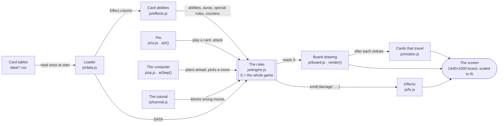
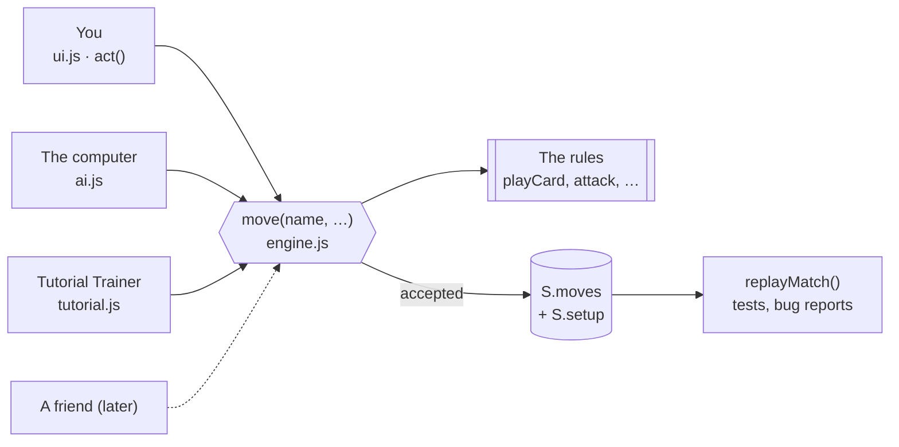
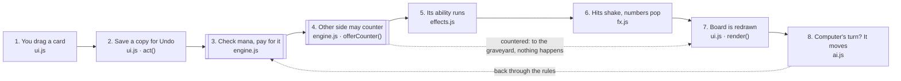
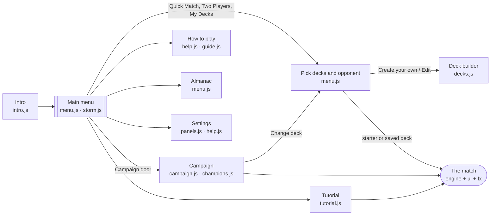

# Code map

How Shardfall's files fit together. For *why* they are built this way, see
[how-it-was-built.md](how-it-was-built.md). Update this page when files are added, split or renamed.
It doesn't need updating for ordinary changes inside a file. For a one-line summary of
every file, see the file table in the [README](../README.md).

## The big picture

All the rules and the whole game state live in `js/engine.js` and the `js/rules-*.js` files beside it. The state is a single object
called `S`: hands, board, health, mana, whose turn it is. The engine never draws anything.
Moves come in from three places, card data comes in from the tables, and the result goes out
to the screen.

The rules are split by job: `js/engine.js` (the core: the state `S`, the front door for moves,
stats, skills, entering the field, the counter window), `js/rules-combat.js` (damage, death,
attacks), `js/rules-turns.js` (players, decks, starting a match, turns and phases),
`js/rules-play.js` (costs, playing a card, targets and choices), `js/rules-champions.js` (one entry
per champion), `js/rules-events.js` (the mini shard falls) and `js/rules-shard.js` (the big shard).
Tests and tools load them all through `tools/rules-code.js`, which reads the list from
`GAME_SCRIPTS`, so a new rules file needs no change in the tools. The core never names a champion: it asks the player's
champion whether it does something at this moment (`champHook()`).

Because the engine never draws, the computer can copy `S`, try a move on the copy
(`simulate()`), and throw the copy away. It does this to plan a whole turn: it tries its best
few plays, then the best few follow-ups to each, and takes the first step of the best line.
Undo works the same way: `act()` saves a copy of `S` before every move.

Kept in the player's browser: settings and hints (`js/help.js`), custom decks
(`js/decks.js`) and campaign progress (`js/campaign.js`). Every saved item is listed in
`SAVE_KEYS` in `js/saves.js`, which also holds the save version (`SAVE_VERSION`, with an upgrade
step per version in `SAVE_UPGRADES`) and the save code (`exportSave()`, `importSave()`; the window
is `showSaveCode()` in `js/panels.js`).

## Moves: one front door, written down

Every move, from you, the computer or the tutorial's Trainer, goes through one front door,
`move(name, …)` in `js/engine.js` (the list of names is `MOVES`). Each accepted move is written
down in `S.moves` as a short note, for example `[0, "play", 41]` (player 1 plays the card with
uid 41). `S.setup` holds how the match began: the seed, both deck lists, and the campaign
champion if there is one. Setup and notes together replay the match exactly (`replayMatch()`),
which is what Play a Friend will send between browsers (plan: `docs/online-play.md`).

Rules for keeping replays exact:
- Real moves go through `move()`. The computer's look-ahead calls the rules directly on a copy,
  which is never written down.
- Nothing outside a move may change `S` (the campaign's champion-in-hand start is
  `campaignChampion()` in the engine for this reason). The tutorial rigs its hands, so lessons
  are marked `S.setup.scripted` and are not replayed.
- The computer's surprise choices use its own dice (`aiRand()` in `js/ai.js`), never the match's.
- A rule must not change the game and then report "refused" (return false).
- Tests: every automatic game in `tools/selftest.js` is replayed from its notes, and
  `tools/replay-test.js` replays recorded matches (`tools/recorded-matches.json`).

## When you play a card

Every move takes the same route, whether it's a card, an attack or an area. Characters and
spells have one extra stop: the other player may counter them.

Steps 3 and 4 are the only place the rules for playing a card live. If a card does the wrong
thing, the fix is in `engine.js` or the card's Effect text. If it looks wrong, the fix is in
`ui.js`, `fx.js` or `css/style.css`.

**The counter stop.** If the other player holds a counter spell that can stop the card and has
the unspent mana, the game pauses with a "Respond?" choice (`S.pending`, kind `choose`,
`resolve: "counter"`). A person answers in the modal in `panels.js`; the computer answers in
`aiResolveChoice()` in `ai.js`. A spell with a target asks for its target first, then opens the
window. The computer's look-ahead never opens the window, so it can't learn what you hold.

## How a card gets its behaviour

Cards are data. What a card does is the **Effect** column of `data/cards.csv`, written as
clauses separated by `;`. `js/effects.js` reads them once at start, checks them, and turns them
into hooks the engine runs. A mistake stops the game with a message naming the card.

| Clause | What it does | Example |
|---|---|---|
| `play:` | When the spell is cast, the Signal character enters, or the ability is used | `play: damage target 3` |
| `enter:` `endTurn:` `attack:` `hurt:` … | When that happens to the card | `endTurn: levelUp self 1` |
| `cost:` | Changes the mana cost | `cost: reduce 1` |
| `aura:` | A lasting bonus while the character or **area** is on the field | `aura: buff allies.Monkey 1 0` |
| `grants:` | Equipment gives its holder a skill | `grants: Swift` |
| `rule:` | Switches on a special engine rule (champions mostly) | `rule: redirect` |
| `counter:` | Makes the card a counter spell | `counter: character spell` |

The engine asks `cardRule(card, "redirect")` and never looks at a card's name, so a card can be
renamed freely and a new card can reuse a rule. Every rule is listed in `RULE_WORDS` in
`js/effects.js` and in `data/README.md`. Oddball one-off abilities are `script` entries in the
same file. `js/data.js` also checks the card table itself for unknown skills, rarities, types
and factions.

## How the screens connect

The campaign and the tutorial are wrappers around a normal match. They pick the decks and add
their own story or coaching, then hand over to the same engine.

## Where to change things

| To change… | Go to |
|---|---|
| Card stats, costs, abilities, deck lists, rule numbers | `data/*.csv` (or the card and deck builder sheet) |
| A new column in a table | `js/data.js` |
| A new kind of card ability | `js/effects.js` |
| A card's fracture, tribes or classes | the Fracture, Tribes and Classes columns of `data/cards.csv`; a bonus for a whole tribe or class is written like `allies.Student` in the Effect column |
| A tribe family (none in use; Undead is now a fracture) | a `tribe_family_<Name>` row in `data/game_rules.csv`; `TRIBE_FAMILIES`, `hasTribe` and `tribesOf` in `js/engine.js`. Rules that name a kind of card (`rule: shepherd Undead`, `rule: sacrifice Monkey`) check it with `isKind` (fracture, then tribe, then class) |
| The symbols for tribes and classes | `TAG_GLYPHS` in `js/cards.js` (placeholders, to be replaced by art) |
| A champion that bends a core rule | its `rule:` clause in the Effect column; the rule itself is in the rules files (`js/rules-combat.js`, `js/rules-play.js` and others; list: `RULE_WORDS` in `js/effects.js`) |
| An area's bonus, or a skill an area grants | the area's `aura:` clause in the Effect column |
| A counter spell | its `counter:` clause in the Effect column; the window is `offerCounter()` in `js/engine.js` |
| How the game plays: turns, phases, combat, winning | turns and phases `js/rules-turns.js`; attacks, damage and winning `js/rules-combat.js`; playing cards and choices `js/rules-play.js`; the core `js/engine.js` |
| How smart the computer is, or how each world's deck plays | `js/ai.js` (`PLAN_DEPTH`, `BATTLE_DEPTH`, `AI_STYLES`) |
| What a champion says, or how the computer plays it | `js/champions.js` (`CHAMPIONS`); the speech bubbles are in `js/campaign.js` |
| Layout, phone layout | `js/ui.js` (the screen state `U`, screens, phone layout); what is drawn on the table is `js/board.js`, taps and drags `js/input.js` |
| How a card looks (frames, art, badges, name fitting) | `cardHTML()` and the rest of `js/cards.js` |
| Pop-up windows: card details, game menu, choices, full log, Settings | `js/panels.js` (`openModal()`, `showDetail()`, `showSettings()`) |
| Deaths, hits and other table reactions to game events | `js/table-effects.js` (`DEATHS`: each world dies its own way) |
| The main menu, deck choice or Almanac | `js/menu.js` |
| The falling-shards menu background | `js/storm.js` |
| Animations and feedback | `js/fx.js` and `css/style.css` |
| Cards moving between deck, hand, table and graveyard; health counting | `js/motion.js` (`motionAfterRender()`, called at the end of `render()`) |
| Where things sit on the table, and card sizes | `L`, `FIELD_W`, `BACK_W` at the top of `js/ui.js` |
| Spots that light up while you drag a card | `setPlacing()` in `js/input.js` (stage classes `placing-…` in `css/style.css`) |
| Health bar and big hits (white chunk, red screen edges, fresh cracks) | `hpBarHTML()`, `bigHit()`, `BIG_HIT` in `js/board.js`; the chunk drains in `js/motion.js` |
| The computer aims before it acts | `aiDecide()` in `js/ai.js` picks the move without making it (`aiStep()` is decide-and-do); `scheduleAI()` in `js/ui.js` shows `aiAim()` (`js/fx.js`) first |
| Heavy attacks wind up, bonuses add up, LETHAL, the killing blow | `windUp()`, `attackParts()`, `fightPreview()` (lethal), `finale()` in `js/fx.js` |
| Spell previews on targets, end-of-turn hourglass, cards reacting to deaths | `targetPreview()`, `eotBadge()`, `reactToDeath()` in `js/fx.js` |
| Draw and skip by themselves, ask before passing early, keyboard shortcuts | `autoFlow()` and `passTurn()` in `js/ui.js`, the `keydown` handler in `js/input.js`; both settings are in Settings |
| Champions speaking in every match against the computer, the end-screen line, deck mastery titles | `championSay()`, `speakerName()`, `recallHTML()`, `MASTERY_TITLES` and `masteryHTML()` in `js/campaign.js`; the lines are in `js/champions.js` |
| Turn history (icons along the top of the battle log) | `histAdd()`, `histHTML()`, `showHist()` in `js/board.js` |
| A deck's record and average cost | `deckRecord()` in `js/campaign.js` (saved with mastery); shown by `masteryLine()` and the deck builder (`js/decks.js`) |
| Card stories (unlock on first play), the end screen's "new stories" line, the Almanac count | `loreHTML()`, `newLoreHTML()`, `loreCount()` in `js/campaign.js`; the text is the Description column of `data/cards.csv` |
| Trophies and the Trophy case | `TROPHIES`, `earnTrophy()`, `showTrophies()` in `js/campaign.js`; the Trophies button is on the start menu |
| Campaign story cards (scene and the champion's words) | `CAMPAIGN` in `js/campaign.js` |
| Drawing the board quickly (only changed pieces are replaced) | `renderRegions()` and `patchChildren()` in `js/ui.js`; `render()` (`js/board.js`) marks regions with `RG(name)` |
| Dozing (all looping effects pause after 20 seconds with nothing happening) | `wake()` and `DOZE_MS` in `js/ui.js`; `html.doze` in `css/style.css` |
| Heavy effects on/off (the always-on looping effects) | `U.heavyFx` and `applyHeavyFx()` in `js/ui.js` (Settings); the `html.light-fx` rules at the end of `css/style.css`; `js/storm.js` holds still |
| Battle log panel, computer speed | `logPanelHTML()`, `showLog()` in `js/board.js`, `AI_SPEEDS` in `js/ui.js`; both are in Settings |
| Colours and sizes | `css/style.css` |
| A new menu button | `index.html`, then `js/menu.js` |
| Intro wording | `js/intro.js` |
| Tutorial steps | `js/tutorial.js` |
| Campaign order and story | `js/campaign.js` |
| Deck-building rules | `js/decks.js` and `data/game_rules.csv` |
| Hint wording and settings | `js/help.js` |
| The Protected rule (half damage to a player with 3+ characters) or the Pierce and Protected skills | `protected_min_characters` in `data/game_rules.csv`; `isProtected()` and `dealDamageToPlayer()` in `js/rules-combat.js`; the plate line `protLine()`, the shard shell on the health gem (`WARD`, `wardHTML()`, `wardHit()`, `wardBreak()`) and the rune ring on Protected cards (`RUNES`, `runeRingHTML()`, `.rune-ring`) in `js/board-marks.js` and `css/style.css`; the Almanac box `protectedRuleHTML()` in `js/menu.js` |
| A "choose a card" window (pick from the graveyard, discard and draw, Soul Shepard, The Man Ape, a counter spell…) | what each kind does is its entry in `CHOICES` in `js/rules-play.js`; the computer's answer is `AI_CHOICES` in `js/ai.js` (kinds without one take the most expensive cards); the window is `showChoose()` in `js/panels.js`; `tools/cards-test.js` checks every kind has an entry |
| A champion's ability or when it levels up | the words and the goal number in `data/champion_abilities.csv`; what each does is its entry in `CHAMPION_RULES` in `js/rules-champions.js` (one entry per champion; the top of that file lists the moments an entry can use, and the engine asks for them with `champHook()`); the line under the player's name is `champLine()` in `js/board.js`, with the text from each entry's `status` or `count` |
| The Almanac's Champions tab (the full explanation and pictures of each ability) | `CHAMP_GUIDE` and `championsHTML()` in `js/menu.js`; keep its notes and numbers in step with the rules in `js/rules-champions.js` |
| The big shard fall (round 8, once a match) | the numbers in `data/game_rules.csv` (`shard_round`, `shard_health`, `shard_draw`, `shard_draw_no_champion`); the rules are `js/rules-shard.js` (`shardFall`, `hitShard`, `claimShard`; each champion's bonus is the `shard` and `shardText` of its entry in `js/rules-champions.js`; an attack on it is `attack(uid, "shard")`); the computer's interest in it is `SHARD_CHIP` in `js/ai.js`; the crystal, the cracked table and the info window are `shardHTML()`, `scarHTML()` and `showShard()` in `js/board-marks.js`, styled at the end of `css/style.css`; test: `tools/shard-test.js` |
| A random event (a mini shard fall in rounds 4 and 12, one round long) | names and descriptions in `data/events.csv`; what each does is `EVENT_ON_START` and `eventNow()` in `js/rules-events.js` (the top of the file says how to add one), with the cost and area-bonus effects in `costFromEffect` and `auraBonus` in `js/effects.js`; the warning card is `eventPill()` in `js/table-effects.js` |
| The board's look (Shattered Crystal and the other skins) | the `.skin-*` rules in `css/style.css`; the list of skins is `SKINS` in `js/board.js`; the long cracks are redrawn by `tools/make-crystal.js` |
| The playable single-file copy | `tools/build-single.js` |
| The version on the menu and the What's new window | `data/whats_new.csv` (top row = the version); `showWhatsNew()` in `js/menu.js`; a row is added with each pull request (`pr-cycle` skill) |
| The "Something went wrong" window and its bug report | `showBugReport()` and `bugReport()` in `js/panels.js` (any uncaught error opens it once per visit); replay a report with `node tools/replay-report.js <file>` |
| Offline play and the home-screen app | `sw.js` (network first, the saved copy after 2 seconds or with no internet; it saves the files listed in `js/data.js` by itself) and `manifest.webmanifest`; registered at the top of `js/boot.js`, only on the real site. Raise `CACHE` in `sw.js` only to throw away every saved copy |
| Something new to save in the browser, or a change to how something is saved | add the key to `SAVE_KEYS` in `js/saves.js`; if old saves need changing, raise `SAVE_VERSION` and add a step to `SAVE_UPGRADES` (test: `tools/saves-test.js`) |
| A new kind of move (anything a player can do) | add it to `MOVES` in `js/engine.js` and send it with `move()`; see "Moves" above |
| Every card played at least once | `tools/cards-test.js` (its table: two plain characters, a Level Up character and an area on each side) |
| Recorded test matches | `tools/replay-test.js`; re-record (with the fingerprints) by `node tools/update-expected.js --write` when play is meant to change |
| Checking a rules or card change broke nothing | `node tools/test-all.js` (every test; GitHub runs it on each push), and `node tools/selftest.js . rand 1000` for a deeper look |
| Checking a screen change in a browser | `node tools/browser-check.js` (uses `tools/serve.js` to load the game from disk and `tools/readability.js` for the "can you read it?" check); the `browser-check` skill in `.claude/skills/` |
| Deck win rates and game length | `node tools/winrates.js` (plays `tools/selftest.js` games and sums them up) |
| How smoothly the game runs | `node tools/speed-check.js` |

## Size and shape

About 7,650 lines of JavaScript in 30 files (November 2026). The largest are `js/tutorial.js` at about
570, `js/fx.js` at about 520 and `js/engine.js` at about 500; `js/board.js` is about 450 since the big
shard, the Protected shell and the rune ring moved to `js/board-marks.js` (the rules were split into seven files in Nov 2026; `js/ui.js`, also split, is about 350). The menu, the Almanac, the menu background and the
start-up code used to live in `ui.js`; they are now `menu.js`, `storm.js` and `boot.js`. In
November 2026 the card drawing (`cards.js`), the table effects (`table-effects.js`) and the pop-up
windows and Settings (`panels.js`) moved out of it too. The scripts
load in the order listed in `GAME_SCRIPTS` in `js/data.js`, with `boot.js` last.

An automatic tool, [Graphify](https://github.com/Graphify-Labs/graphify), found the same
structure (400 functions and 921 connections on 13 November). Its busiest functions were
`emit()`, `render()`, `log()`, `hasSkill()`, `playCard()` and `attack()`. A tool like that
becomes worth running regularly once the code is around 20,000 lines.
