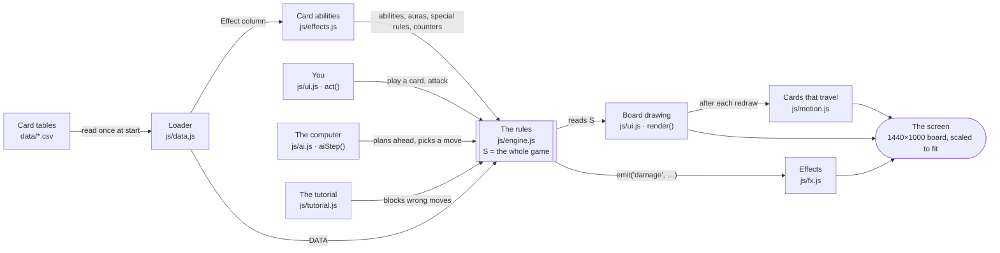
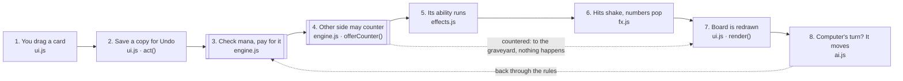
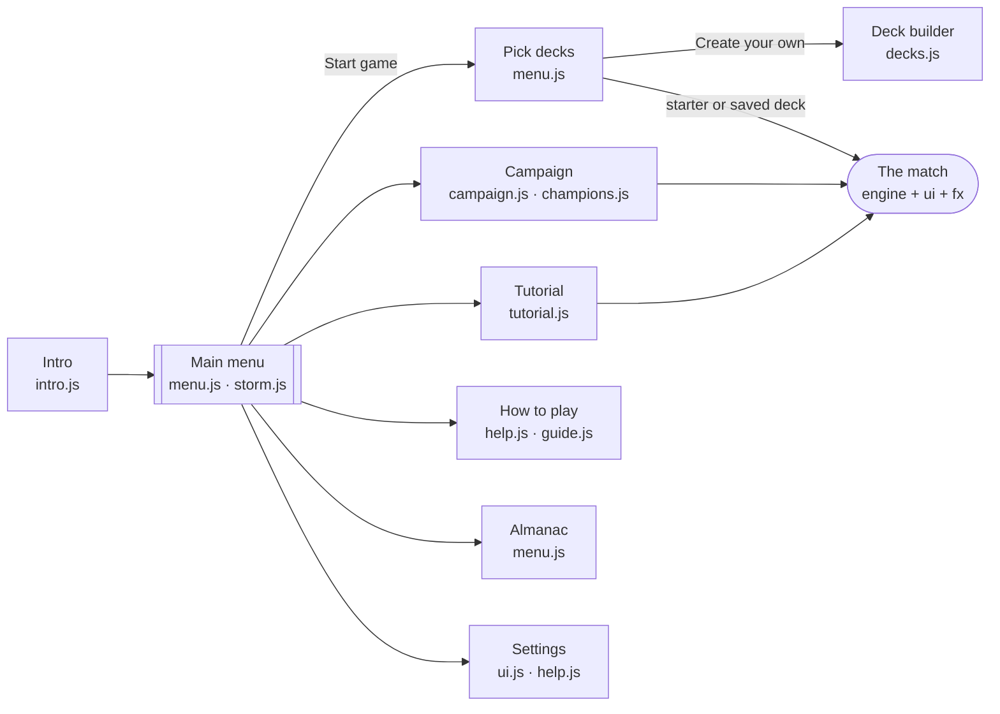

# Code map

How Shardfall's files fit together. Update this page when files are added, split or renamed.
It doesn't need updating for ordinary changes inside a file. For a one-line summary of
every file, see the file table in the [README](../README.md).

## The big picture

All the rules and the whole game state live in `js/engine.js`. The state is a single object
called `S`: hands, board, health, mana, whose turn it is. The engine never draws anything.
Moves come in from three places, card data comes in from the tables, and the result goes out
to the screen.

Because the engine never draws, the computer can copy `S`, try a move on the copy
(`simulate()`), and throw the copy away. It does this to plan a whole turn: it tries its best
few plays, then the best few follow-ups to each, and takes the first step of the best line.
Undo works the same way: `act()` saves a copy of `S` before every move.

Kept in the player's browser: settings and hints (`js/help.js`), custom decks
(`js/decks.js`) and campaign progress (`js/campaign.js`).

## When you play a card

Every move takes the same route, whether it's a card, an attack or an area. Characters and
spells have one extra stop: the other player may counter them.

Steps 3 and 4 are the only place the rules for playing a card live. If a card does the wrong
thing, the fix is in `engine.js` or the card's Effect text. If it looks wrong, the fix is in
`ui.js`, `fx.js` or `css/style.css`.

**The counter stop.** If the other player holds a counter spell that can stop the card and has
the unspent mana, the game pauses with a "Respond?" choice (`S.pending`, kind `choose`,
`resolve: "counter"`). A person answers in the modal in `ui.js`; the computer answers in
`aiResolveChoice()` in `ai.js`. A spell with a target asks for its target first, then opens the
window. The computer's look-ahead never opens the window, so it can't learn what you hold.

## How a card gets its behaviour

Cards are data. What a card does is the **Effect** column of `data/cards.csv`, written as
clauses separated by `;`. `js/effects.js` reads them once at start, checks them, and turns them
into hooks the engine runs. A mistake stops the game with a message naming the card.

| Clause | What it does | Example |
|---|---|---|
| `play:` | When the spell is cast, the Signal character enters, or the ability is used | `play: damage target 3` |
| `enter:` `endTurn:` `attack:` `hurt:` … | When that happens to the card | `endTurn: levelUp self 1` |
| `cost:` | Changes the mana cost | `cost: reduce 1` |
| `aura:` | A lasting bonus while the character or **area** is on the field | `aura: buff allies.Monkey 1 0` |
| `grants:` | Equipment gives its holder a skill | `grants: Swift` |
| `rule:` | Switches on a special engine rule (champions mostly) | `rule: redirect` |
| `counter:` | Makes the card a counter spell | `counter: character spell` |

The engine asks `cardRule(card, "redirect")` and never looks at a card's name, so a card can be
renamed freely and a new card can reuse a rule. Every rule is listed in `RULE_WORDS` in
`js/effects.js` and in `data/README.md`. Oddball one-off abilities are `script` entries in the
same file. `js/data.js` also checks the card table itself for unknown skills, rarities, types
and factions.

## How the screens connect

The campaign and the tutorial are wrappers around a normal match. They pick the decks and add
their own story or coaching, then hand over to the same engine.

## Where to change things

| To change… | Go to |
|---|---|
| Card stats, costs, abilities, deck lists, rule numbers | `data/*.csv` (or the card and deck builder sheet) |
| A new column in a table | `js/data.js` |
| A new kind of card ability | `js/effects.js` |
| A card's fracture, tribes or classes | the Fracture, Tribes and Classes columns of `data/cards.csv`; a bonus for a whole tribe or class is written like `allies.Student` in the Effect column |
| A tribe family (Undead = Zombie, later Skeleton, Vampire …) | the `tribe_family_Undead` row in `data/game_rules.csv`; `TRIBE_FAMILIES`, `hasTribe` and `tribesOf` in `js/engine.js` |
| The symbols for tribes and classes | `TAG_GLYPHS` in `js/ui.js` (placeholders, to be replaced by art) |
| A champion that bends a core rule | its `rule:` clause in the Effect column; the rule itself is in `js/engine.js` (list: `RULE_WORDS` in `js/effects.js`) |
| An area's bonus, or a skill an area grants | the area's `aura:` clause in the Effect column |
| A counter spell | its `counter:` clause in the Effect column; the window is `offerCounter()` in `js/engine.js` |
| How the game plays: turns, phases, combat, winning | `js/engine.js` |
| How smart the computer is, or how each faction plays | `js/ai.js` (`PLAN_DEPTH`, `BATTLE_DEPTH`, `AI_STYLES`) |
| What a champion says, or how the computer plays it | `js/champions.js` (`CHAMPIONS`); the speech bubbles are in `js/campaign.js` |
| Layout, card look, phone layout | `js/ui.js` |
| The main menu, deck choice or Almanac | `js/menu.js` |
| The falling-shards menu background | `js/storm.js` |
| Animations and feedback | `js/fx.js` and `css/style.css` |
| Cards moving between deck, hand, table and graveyard; health counting | `js/motion.js` (`motionAfterRender()`, called at the end of `render()`) |
| Where things sit on the table, and card sizes | `L`, `FIELD_W`, `BACK_W` at the top of `js/ui.js` |
| Spots that light up while you drag a card | `setPlacing()` in `js/ui.js` (stage classes `placing-…` in `css/style.css`) |
| Health bar and big hits (white chunk, red screen edges, fresh cracks) | `hpBarHTML()`, `bigHit()`, `BIG_HIT` in `js/ui.js`; the chunk drains in `js/motion.js` |
| The computer aims before it acts | `aiDecide()` in `js/ai.js` picks the move without making it (`aiStep()` is decide-and-do); `scheduleAI()` in `js/ui.js` shows `aiAim()` (`js/fx.js`) first |
| Heavy attacks wind up, bonuses add up, LETHAL, the killing blow | `windUp()`, `attackParts()`, `fightPreview()` (lethal), `finale()` in `js/fx.js` |
| Spell previews on targets, end-of-turn hourglass, cards reacting to deaths | `targetPreview()`, `eotBadge()`, `reactToDeath()` in `js/fx.js` |
| Draw and skip by themselves, ask before passing early, keyboard shortcuts | `autoFlow()`, `passTurn()` and the `keydown` handler in `js/ui.js`; both settings are in Settings |
| Battle log panel, computer speed | `logPanelHTML()`, `showLog()`, `AI_SPEEDS` in `js/ui.js`; both are in Settings |
| Colours and sizes | `css/style.css` |
| A new menu button | `index.html`, then `js/menu.js` |
| Intro wording | `js/intro.js` |
| Tutorial steps | `js/tutorial.js` |
| Campaign order and story | `js/campaign.js` |
| Deck-building rules | `js/decks.js` and `data/game_rules.csv` |
| Hint wording and settings | `js/help.js` |
| The Protected rule (half damage to a player with 3+ characters) or the Pierce and Protected skills | `protected_min_characters` in `data/game_rules.csv`; `isProtected()` and `dealDamageToPlayer()` in `js/engine.js`; the plate line `protLine()`, the shard shell on the health gem (`WARD`, `wardHTML()`, `wardHit()`, `wardBreak()`) and the rune ring on Protected cards (`RUNES`, `runeRingHTML()`, `.rune-ring`) in `js/ui.js` and `css/style.css`; the Almanac box `protectedRuleHTML()` in `js/menu.js` |
| A champion's ability or when it levels up | the words and the goal number in `data/champion_abilities.csv`; what each does is the "Champion abilities" section of `js/engine.js` (`championBonus`, `chestThump`, `bossPhaseCheck`); the line under the player's name is `champLine()` in `js/ui.js`, with the text for abilities without levels from `champStatus()` in `js/engine.js` |
| The Almanac's Champions tab (the full explanation and pictures of each ability) | `CHAMP_GUIDE` and `championsHTML()` in `js/menu.js`; keep its notes and numbers in step with the rules in `js/engine.js` |
| The big shard fall (round 8, once a match) | the numbers in `data/game_rules.csv` (`shard_round`, `shard_health`, `shard_draw`, `shard_draw_no_champion`); the rules, including each champion's `SHARD_BONUS`, are "The big shard fall" in `js/engine.js` (`shardFall`, `hitShard`, `claimShard`; an attack on it is `attack(uid, "shard")`); the computer's interest in it is `SHARD_CHIP` in `js/ai.js`; the crystal, the cracked table and the info window are `shardHTML()`, `scarHTML()` and `showShard()` in `js/ui.js`, styled at the end of `css/style.css`; test: `tools/shard-test.js` |
| A random event (a mini shard fall in rounds 4 and 12, one round long) | names and descriptions in `data/events.csv`; what each does is `EVENT_ON_START` and `eventNow()` in `js/engine.js`, with the cost and area-bonus effects in `costFromEffect` and `auraBonus` in `js/effects.js`; the warning card is `eventPill()` in `js/ui.js` |
| The board's look (Shattered Crystal and the other skins) | the `.skin-*` rules in `css/style.css`; the list of skins is `SKINS` in `js/ui.js`; the long cracks are redrawn by `tools/make-crystal.js` |
| The playable single-file copy | `tools/build-single.js` |
| Checking a rules or card change broke nothing | `node tools/test-all.js` (every test; GitHub runs it on each push), and `node tools/selftest.js . rand 1000` for a deeper look |

## Size and shape

About 5,400 lines of JavaScript in 16 files (November 2026). The largest are `js/engine.js` at
about 1,030 and `js/ui.js` at about 1,200. The menu, the Almanac, the menu background and the
start-up code used to live in `ui.js`; they are now `menu.js`, `storm.js` and `boot.js`. The scripts
load in the order listed in `GAME_SCRIPTS` in `js/data.js`, with `boot.js` last.

An automatic tool, [Graphify](https://github.com/Graphify-Labs/graphify), found the same
structure (400 functions and 921 connections on 13 November). Its busiest functions were
`emit()`, `render()`, `log()`, `hasSkill()`, `playCard()` and `attack()`. A tool like that
becomes worth running regularly once the code is around 20,000 lines.
