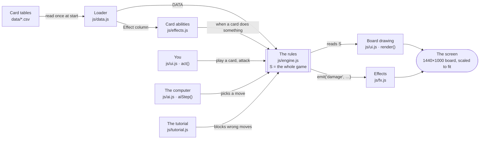
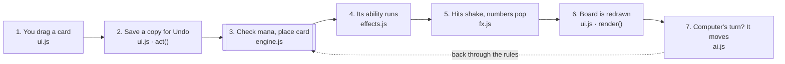
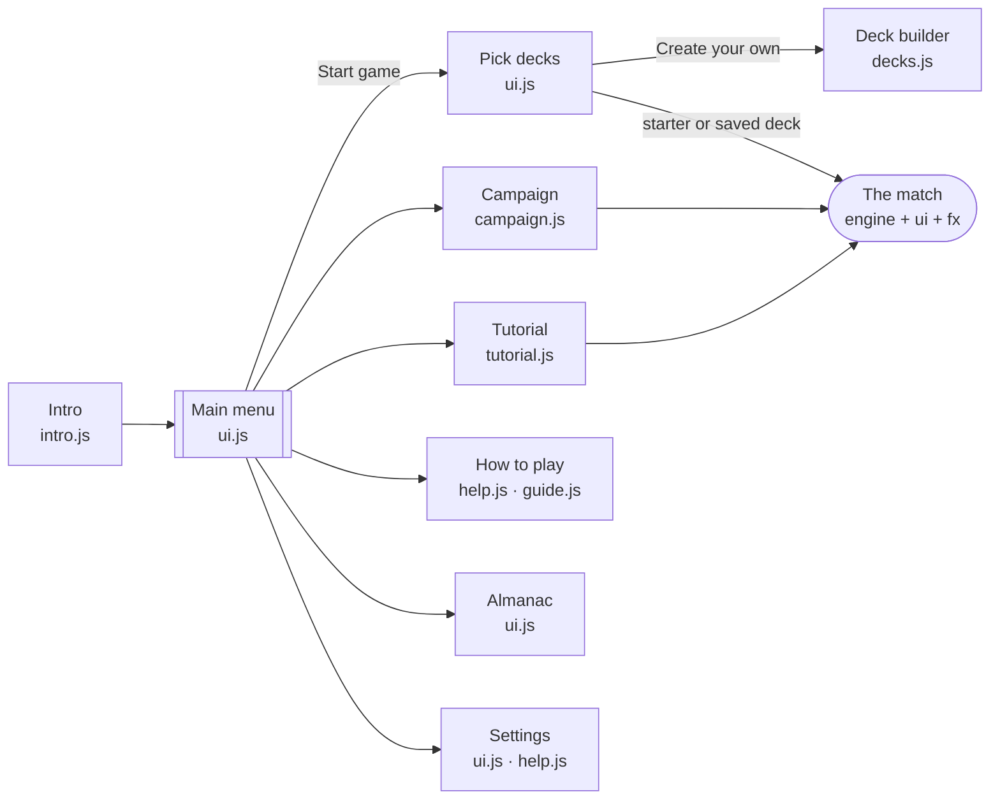

# Code map

How Shardfall's files fit together. Update this page when files are added, split or renamed.
It doesn't need updating for ordinary changes inside a file. For a one-line summary of
every file, see the file table in the [README](../README.md).

## The big picture

All the rules and the whole game state live in `js/engine.js`. The state is a single object
called `S`: hands, board, health, mana, whose turn it is. The engine never draws anything.
Moves come in from three places, card data comes in from the tables, and the result goes out
to the screen.

Because the engine never draws, the computer can copy `S`, try a move on the copy
(`simulate()`), and throw the copy away. Undo works the same way: `act()` saves a copy of
`S` before every move.

Kept in the player's browser: settings and hints (`js/help.js`), custom decks
(`js/decks.js`) and campaign progress (`js/campaign.js`).

## When you play a card

Every move takes the same route, whether it's a card, an attack or an area.

Step 3 is the only place the rules live. If a card does the wrong thing, the fix is in
`engine.js` or the card's Effect text. If it looks wrong, the fix is in `ui.js`, `fx.js` or
`css/style.css`.

## How the screens connect

The campaign and the tutorial are wrappers around a normal match. They pick the decks and add
their own story or coaching, then hand over to the same engine.

## Where to change things

| To change… | Go to |
|---|---|
| Card stats, costs, abilities, deck lists, rule numbers | `data/*.csv` (or the card and deck builder sheet) |
| A new column in a table | `js/data.js` |
| A new kind of card ability | `js/effects.js` |
| How the game plays: turns, phases, combat, winning | `js/engine.js` |
| How smart or aggressive the computer is | `js/ai.js` |
| Layout, card look, menus, phone layout | `js/ui.js` |
| Animations and feedback | `js/fx.js` and `css/style.css` |
| Colours and sizes | `css/style.css` |
| A new menu button | `index.html`, then `js/ui.js` |
| Intro wording | `js/intro.js` |
| Tutorial steps | `js/tutorial.js` |
| Campaign order and story | `js/campaign.js` |
| Deck-building rules | `js/decks.js` and `data/game_rules.csv` |
| Hint wording and settings | `js/help.js` |
| The playable single-file copy | `tools/build-single.js` |

## Size and shape

About 4,900 lines of JavaScript in 12 files (November 2026). The largest is `js/ui.js` at about
1,375 lines. It mixes the menu, the Almanac, board drawing and input, so it is the first
candidate to split if it passes about 2,000 lines.

An automatic tool, [Graphify](https://github.com/Graphify-Labs/graphify), found the same
structure. Its busiest functions were `emit()`, `render()`, `playCard()` and `attack()`. A
tool like that becomes worth running regularly once the code is around 20,000 lines.
