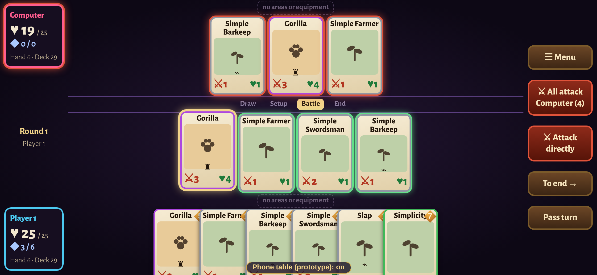

# Phone-only table: plan

Status: **DISCONTINUED. Kept for reference only; not in the game and not being built.**
On 11 November 2026 the owner decided the current phone layout is good enough. The demo page
on claude.ai was deleted. This page and `prototype.js` stay in case the idea is revived. If it
is, the prototype proved it works, and the plan below says how it would be built.



## The problem

The table is drawn at 1440×1000 and shrunk to fit. On a phone held sideways that is about 40%,
so card names end up about 4 pixels tall. Bigger fonts help a little, but the real fix is a
table laid out for the phone's own size.

## The idea

The rules (`js/engine.js`) don't know where anything is on screen. Everything about layout
lives in the drawing code in `js/ui.js`. So a phone layout is **a second drawing of the same
game**, not a second game:

- `render()` still draws the normal table. On a phone it is invisible.
- A phone drawing (`renderPhone()`) reads the same game state `S` and draws a table sized for
  the real screen, with no shrinking.
- Every tap on the phone table "presses" the matching thing on the normal table. So selecting,
  attacking, targeting, Undo, the counter-spell window, hints and the computer's turn all run
  through the code that already works.

## What the prototype showed (checked in a browser at 740×360, 844×390 and 932×430)

| | Today (shrunk table) | Phone table |
|---|---|---|
| Card on the table | about 40×57 px | 69×99 to 88×125 px |
| Card name | about 4 px | 11.5 px |
| Attack and health | about 4 px | 16 px |

Selecting and attacking a character, All attack, playing a card from the hand (tap it, then
Play) and the phase buttons all worked through the phone table, with no errors.

## Layout

```
┌────────┬──────────────────────────────────────┬────────┐
│ Them   │ their areas and equipment (chips)    │        │
│ ♥ 19   │ their characters                     │ Menu   │
│ ◆ 0/0  ├── Draw  Setup  Battle  End  message ─┤ All    │
│        │ your characters                      │ attack │
│ Round  │ your areas and equipment (chips)     │ Phase  │
│ You    │ your hand (peeks up; tap to read     │ Pass   │
│ ♥ 25   │ and play)                            │        │
└────────┴──────────────────────────────────────┴────────┘
```

- **Compact card:** name, art, skill icons, big attack and health. No type line, no skill
  names. Tapping any card opens the full card (this already exists).
- **Areas and equipment** become small name chips. They take a lot of room on the big table and
  rarely need reading mid-turn.
- **The hand** peeks up from the bottom. Tap a card to read it and play it. Dragging would be
  added in the real version.
- Card size is worked out from the screen height, so it fits any phone.

## Building it for real

Rough order, smallest risk first:

1. **Move the prototype into the game:** a new file `js/phone.js` with `renderPhone()`, its
   CSS in `css/style.css`, and a switch in `fitStage()`: phone table on short wide screens, the
   normal table everywhere else. Small.
2. **Feedback on the phone table:** hits, floating damage numbers, deaths and the screen shake
   now play on the hidden table. `js/fx.js` finds things by their position on the table, so it
   needs to look them up on whichever table is showing. Medium. **This is the biggest job.**
3. **Drag to play** from the phone hand, plus "drop here" highlights. Medium.
4. **The aiming arrow, the counter window and target prompts** shown in the middle bar.
   Small.
5. **Tutorial:** its pointers are placed by table coordinates (`stageRect` in
   `js/tutorial.js`); they need positions from the phone table. Small to medium.
6. **Hotseat curtain and end screen** on the phone table. Small.
7. **Tests:** run the existing browser checks at three phone sizes.

Nothing in the rules, the computer opponent, the card data or the deck builder changes.

## Risks

- **Two drawings to keep in step.** Each new board feature (a new zone, badge or button) needs
  adding to both tables. The prototype reads "can attack", "can target" and similar from the
  normal table, so the decisions stay in one place, but the drawing is still done twice.
- **Effects are the main cost** (step 2). Without them the phone table works but feels flat.
- **Very many characters:** a row fits about 6 at full size. More need squeezing, as the big
  table already does.

## Alternative considered

Rewrite the one table so it lays itself out for any screen size. That's cleaner in the long run
but means reworking every drawing and effect, with a much bigger risk of breaking the desktop
table. The second-drawing approach can be added a step at a time and leaves the desktop table
alone.
